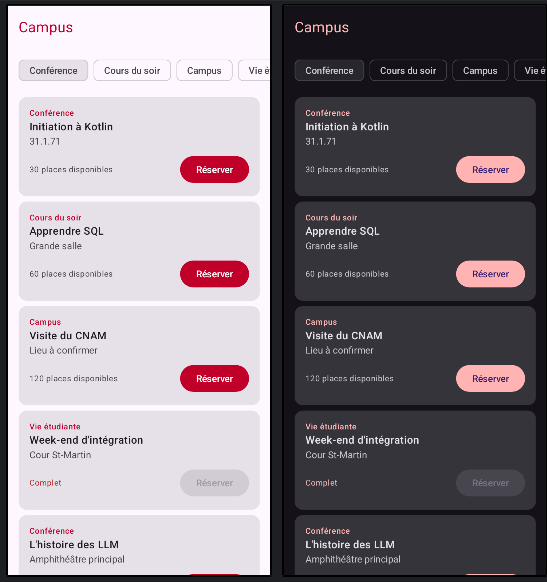
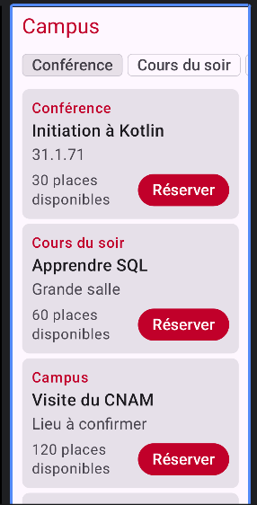

# Exercice Campus Part. 1 & Part. 2

Rendu de l'exercice de cours, Campus.

## Previews

### Liste d'EventCard

### EventDetail

### Liste avec DP à 200%

## Fonctions ajoutées non-demandées

Pour rendre le code plus lisible, deux fonctions ont été ajoutées :

`CategoryRow` : Pour créer une LazyRow dédié aux catégories d'event
`SeatsText` : Pour gérer les différents affichages du texte du nombre de place d'un event (Complet, 1 place disponibles, X places disponibles)